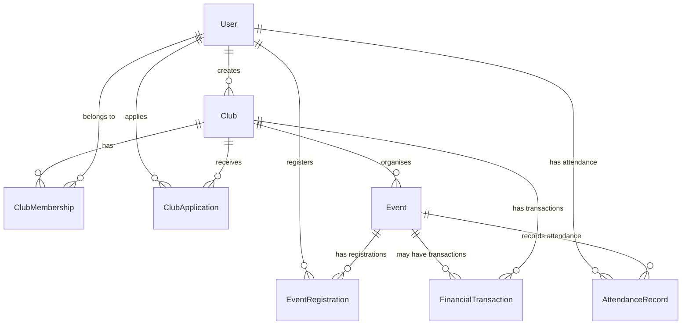

# Giai đoạn 2 — Phân tích và thiết kế database

## 1. Mục tiêu
- Thiết kế cơ sở dữ liệu quan hệ phù hợp, giảm thiểu trùng lặp dữ liệu.
- Đảm bảo các ràng buộc toàn vẹn (FK, UNIQUE, NOT NULL, CHECK).
- Chuẩn bị cho việc sử dụng **EF Core Code‑First** và **migration**.

## 2. Các bảng (Entity) dự kiến
| Entity | Thuộc tính (cột) | Kiểu dữ liệu (SQL) | Ghi chú |
|--------|------------------|--------------------|--------|
| **User** (Identity) | Id (PK) | BIGINT | Auto‑increment |
| | Username | NVARCHAR(50) | UNIQUE, NOT NULL |
| | Email | NVARCHAR(100) | UNIQUE, NOT NULL |
| | PasswordHash | NVARCHAR(200) | NOT NULL |
| | CreatedAt | DATETIME2 | DEFAULT GETUTCDATE() |
| **Club** | Id (PK) | BIGINT | Auto‑increment |
| | Name | NVARCHAR(100) | NOT NULL |
| | Description | NVARCHAR(500) | NULL |
| | CreatedByUserId (FK → User.Id) | BIGINT | NOT NULL |
| | CreatedAt | DATETIME2 | DEFAULT GETUTCDATE() |
| **ClubMembership** | Id (PK) | BIGINT | Auto‑increment |
| | ClubId (FK → Club.Id) | BIGINT | NOT NULL |
| | MemberId (FK → User.Id) | BIGINT | NOT NULL |
| | Role | NVARCHAR(20) | CHECK (Role IN ('Chủ nhiệm','Thành viên')) |
| | JoinedAt | DATETIME2 | DEFAULT GETUTCDATE() |
| | UNIQUE (ClubId, MemberId) |
| **ClubApplication** | Id (PK) | BIGINT | Auto‑increment |
| | ClubId (FK) | BIGINT | NOT NULL |
| | ApplicantId (FK → User.Id) | BIGINT | NOT NULL |
| | Status | NVARCHAR(20) | CHECK (Status IN ('Pending','Approved','Rejected')) |
| | SubmittedAt | DATETIME2 | DEFAULT GETUTCDATE() |
| | ReviewedAt | DATETIME2 | NULL |
| **Event** | Id (PK) | BIGINT | Auto‑increment |
| | ClubId (FK) | BIGINT | NOT NULL |
| | Title | NVARCHAR(150) | NOT NULL |
| | Description | NVARCHAR(1000) | NULL |
| | Location | NVARCHAR(200) | NULL |
| | StartTime | DATETIME2 | NOT NULL |
| | EndTime | DATETIME2 | NOT NULL |
| | Capacity | INT | NULL |
| | IsRegistrationOpen | BIT | DEFAULT 1 |
| **EventRegistration** | Id (PK) | BIGINT | Auto‑increment |
| | EventId (FK) | BIGINT | NOT NULL |
| | UserId (FK) | BIGINT | NOT NULL |
| | RegisteredAt | DATETIME2 | DEFAULT GETUTCDATE() |
| | UNIQUE (EventId, UserId) |
| **AttendanceRecord** | Id (PK) | BIGINT | Auto‑increment |
| | EventId (FK) | BIGINT | NOT NULL |
| | UserId (FK) | BIGINT | NOT NULL |
| | IsPresent | BIT | NOT NULL |
| | RecordedAt | DATETIME2 | DEFAULT GETUTCDATE() |
| **FinancialTransaction** | Id (PK) | BIGINT | Auto‑increment |
| | ClubId (FK) | BIGINT | NOT NULL |
| | EventId (FK) | BIGINT | NULL |
| | Amount | DECIMAL(12,2) | NOT NULL |
| | Type | NVARCHAR(10) | CHECK (Type IN ('Thu','Chi')) |
| | Description | NVARCHAR(500) | NULL |
| | TransactionDate | DATETIME2 | DEFAULT GETUTCDATE() |

## 3. ERD (Mermaid)


## 4. Các ràng buộc quan trọng
- **PK**: Id ở mỗi bảng.
- **FK**: Liên kết các bảng như mô tả, dùng `ON DELETE CASCADE` cho các quan hệ phụ thuộc (ClubMembership, EventRegistration, ...).
- **UNIQUE**: `User.Username`, `User.Email`, `ClubMembership (ClubId, MemberId)`, `EventRegistration (EventId, UserId)`, `ClubApplication (ClubId, ApplicantId)`.
- **CHECK**: Các cột `Role`, `Status`, `Type` để giới hạn giá trị.
- **INDEX**: Tạo index trên các cột thường truy vấn như `ClubId`, `UserId`, `EventId` để tăng hiệu suất.

## 5. Bước thực hiện
1. **Tạo các Entity C#** trong thư mục `Models` (User.cs, Club.cs, …) và khai báo ràng buộc bằng Data Annotations hoặc Fluent API.
2. **Cấu hình DbContext**
```csharp
public class AppDbContext : DbContext
{
    public DbSet<User> Users { get; set; }
    public DbSet<Club> Clubs { get; set; }
    public DbSet<ClubMembership> ClubMemberships { get; set; }
    public DbSet<ClubApplication> ClubApplications { get; set; }
    public DbSet<Event> Events { get; set; }
    public DbSet<EventRegistration> EventRegistrations { get; set; }
    public DbSet<AttendanceRecord> AttendanceRecords { get; set; }
    public DbSet<FinancialTransaction> FinancialTransactions { get; set; }

    protected override void OnModelCreating(ModelBuilder modelBuilder)
    {
        modelBuilder.Entity<User>()
            .HasIndex(u => u.Username).IsUnique();
        // Thêm các ràng buộc, quan hệ, check constraint ở đây
    }
}
```
3. **Chạy migration**
```bash
dotnet ef migrations add InitialCreate
dotnet ef database update
```
   - Đảm bảo `appsettings.json` có chuỗi kết nối MySQL.
4. **Kiểm tra DB** bằng MySQL Workbench hoặc CLI để xác nhận các bảng, ràng buộc và index.
5. **Seed dữ liệu mẫu** (DbInitializer) để tạo một vài CLB, người dùng, sự kiện mẫu cho phát triển UI.

## 6. Kiểm thử DB
- Viết unit test cho các repository để kiểm tra CRUD và ràng buộc (ví dụ: không tạo `ClubMembership` trùng). 
- Kiểm tra transaction: khi tạo sự kiện và đăng ký, nếu một bước thất bại toàn bộ phải rollback.

---
### 🎯 Kết luận
Hoàn thành Giai đoạn 2 sẽ cho bạn một mô hình dữ liệu chuẩn hoá, mạnh mẽ và sẵn sàng cho các tính năng tiếp theo (tạo project, kết nối MySQL, xây dựng model, …). Nếu cần file mẫu C# cho từng Entity hoặc mẫu migration, hãy cho tôi biết.
